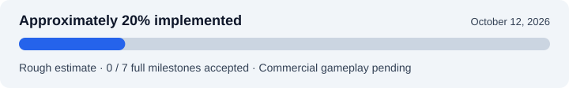

# CTR2WUP

**A project to turn 3DS games into individual Wii U titles through a Windows GUI.**

The intended experience follows [UWUVCI AIO](https://github.com/stuff-by-3-random-dudes/UWUVCI-AIO-WPF):
choose a decrypted game, customize its name and artwork, click **Inject**, and
receive a WUP package to install and launch from the Wii U Menu.
The TV displays the top screen; the GamePad supplies the bottom screen, touch,
and controls.

**CTR2WUP is in early development. It cannot yet convert or play commercial 3DS
games, and the Windows GUI has not been implemented.** Current builds are
developer tools and original homebrew diagnostics. **Super Mario 3D Land** is the
first planned supported game; its exact revision still needs private analysis.

## How it will work

**Select game → Configure title → Inject → Install WUP → Play on Wii U**

During injection, the PC will translate the game's ARM code into code compiled
for the Wii U's PowerPC CPU. A shared compatibility runtime will provide the
required 3DS services, graphics, input, audio, and saves. Each package will contain
the translated program, runtime, and game assets.

The first release targets one verified game revision. Support for additional
games will grow as the shared runtime gains the features they require. See the
[product plan](docs/development-plan.md) and [GUI workflow](docs/gui-workflow.md).

## Overall progress



**Assessment: October 9, 2026 · runtime version 0.14.0.** About **20%** is a rough
engineering estimate toward the finished GUI-to-playable-WUP product, not a
measured task percentage or a compatibility rating. **0 of 7 full milestones
have met their acceptance criteria.** Most renderer, commercial-game, GUI, and
hardware validation work remains.

| Milestone | Current status | Main remaining work |
|---|---|---|
| M1 · Wii U platform | Diagnostic builds ready | Physical screens, input, sound, exit, and installation tests |
| M2 · CPU translation | Tested subset and AOT integration | Broader instruction support and Wii U performance |
| M3 · Homebrew runtime | Six original applications verified on desktop | Broader services and console execution/stability |
| M4 · PICA → GX2 graphics | Renderer not implemented | 3DS draws, shaders, textures, and reference scenes |
| M5 · First commercial game | Mario selected; dump analysis pending | Boot, gameplay, guest audio, and retail saves |
| M6 · Automated WUP conversion | Build and packaging foundations tested | Commercial end-to-end conversion, Windows, and installer acceptance |
| M7 · Windows GUI | Workflow specified | Implement and verify the complete Inject experience |

Read the [completion assessment](docs/progress.md) for the reasoning and evidence,
or the [milestone checklist](docs/milestones.md) for detailed acceptance gates.

## What works today

- **Game inspection:** bounded parsing of decrypted 3DS/CXI/CIA inputs and
  executable metadata, with explicit rejection of unsupported or encrypted data.
- **Translation and runtime foundations:** ARM/Thumb/VFP subsets, external AOT
  integration, checked memory, guest threads, and scoped 3DS services.
- **Original homebrew execution:** normal compiler-built programs exercise boot,
  threads, input, CPU-written two-screen images, private save/reload, and
  standalone application startup and exit.
- **Wii U diagnostic builds:** five RPX/WUHB variants are compiled, including
  interactive input/display and persistent-save tests. Physical execution is pending.
- **Packaging foundations:** original metadata/artwork staging and encrypted
  packing with independent decryption and file checks using synthetic test inputs.
  Actual WUP installation remains unverified.

CPU-written framebuffer display is implemented; **3DS PICA rendering and guest
audio are not**. Homebrew snapshot persistence does not establish commercial save
compatibility. Commercial conversion requests fail explicitly instead of producing
a placeholder package. The separate Windows CIA intake helper is a console
utility, not the planned injector GUI.

## Try the developer tools

The following Linux/cloud workflow builds an original Wii U diagnostic and runs
an original synthetic 3DS fixture. Use the repository root with Python 3.12+,
Make, and a C compiler; the SDK installer provisions the Wii U toolchain.
The first SDK installation also requires Docker.

```sh
bash tools/install-wiiu-sdk.sh
python3 -m host doctor
make check
python3 -m host build --target prototype --output "artifacts/my diagnostic"
python3 -m host make-fixture --output "artifacts/my fixture"
python3 -m host run-fixture "artifacts/my fixture/ctr2wup-guest.cxi" --output "artifacts/my guest frames"
```

The outputs are **RPX/WUHB diagnostics and reference images**, not installable
commercial-game WUPs. Generated builds and reports are kept in ignored
`artifacts/` directories. See [fixture builds](docs/guest-fixture.md),
[compiled homebrew](docs/compiled-homebrew.md), and
[external translation setup](docs/upstream-integration.md) for further workflows.

To inspect a decrypted dump locally, run `python3 -m host inspect PATH`.
Keep ROMs and derived game data under ignored `private/` directories.
See [CIA intake](docs/cia-intake.md) for the small private executable export helper.

## Development and testing

- [Current status and reports](STATUS.md) — implementation history and verification evidence.
- [Next testing and input gates](docs/current-roadblock.md) — what awaits a dump, Wii U, or Windows test.
- [Console testing](docs/console-testing.md) — launch and record the diagnostic results.
- [Windows build notes](docs/build-windows.md) — prerequisites and pending native Windows checks.
- [Architecture](docs/architecture.md) and [compatibility](docs/compatibility.md) — supported behavior and limits.
- [Packaging](docs/packaging.md) — local requirements and the distinction between integrity and installation.
- [Project requirements](docs/project-brief.md) — the original development brief.

No ROMs, commercial assets, keys, or proprietary SDK are bundled. Keep saves,
translated commercial code, packages, traces, and credentials private as well.
Original fixtures and linked support carry the notices recorded in
[THIRD_PARTY_NOTICES](THIRD_PARTY_NOTICES). Dependency and redistribution limits
are documented in the [foundation audit](docs/foundation-audit.md).
