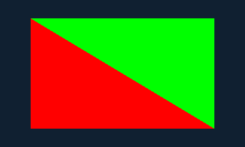

# Compiled original guest PICA draws

Version **0.23.0** connects a bounded PICA draw subset to the standard guest GSP
queue. An original normal-CRT ARM application uses unmodified pinned libctru to
submit two command lists, retain uploaded shader/state between them, render
indexed triangles into owned linear allocations and display both screens.
This is CPU software rendering followed by GX display transfers and existing
native presentation. General PICA behavior and native GX2 shader translation
remain open under M4.

## Reproduce the checkpoint

After the [verified SDK and ARM fixture setup](compiled-homebrew.md), run:

```sh
python3 tools/validate-libctru.py --application draw --wiiu --sanitize \
  --output artifacts/reports/compiled-draw-local
```

The output directory must be new. The report records the source commit and dirty
state, library pin/hash, generated code identity, exact frame comparisons and
RPX/WUHB hashes. The original program executes **17,420,794 ARM instructions**
with zero fallback, four draws, four triangles, **97,200 covered fragments** and
36 vertex shader instructions. Its own target and transferred framebuffer checks
must pass before it prints `CTR2WUP compiled PICA draws PASS` and exits.

The host runner checks every displayed pixel. A separate integer Python image
oracle independently compares all **172,800 top/bottom pixels** in the captured
PPMs. The two images show a dark background and a central region divided diagonally into
red and green triangles; top and bottom display sizes are 400×240 and 320×240.

Original host captures; the October 13 physical run has separate user picture
confirmation and the guest's own target/readback PASS:




CI executes the sanitized original guest and native build on each PR. Download
`wiiu-guest-draws-<source commit>` for the checked RPX/WUHB, PPM images, report,
checksums, source/SDK provenance and notices. This artifact contains original
diagnostics; it is not a game WUP or a physical-console result.

## Resource and transaction contract

- Commands arrive through the existing standard GSP/GX command-list operation;
  configuration-only lists retain the previous behavior.
- Vertex/index resources and targets resolve only to tracked owned Old-family
  linear allocations: guest VA `0x14000000` maps to PA `0x20000000`. Static guest
  mappings, VRAM and unowned physical addresses are rejected.
- Permission splits must retain allocation identity. Source spans need read
  permission; tiled targets need read/write permission. Snapshots are bounded to
  4 MiB. Relay memory, command-list/target aliases and source/target feedback fail.
- One resource base and one target binding are supported per command list.
  Changing either between draws fails transactionally. State writes after the
  last draw may prepare the next list; shader/configuration-only uploads persist.
- Targets are 8×8 Morton tiled RGBA8/ABGR storage, with dimensions that are multiples
  of eight and no larger than 512. The adapter converts to the renderer's linear
  RGBA view, then writes the complete target through checked guest memory once.
- Supported fragment state is explicitly defined: primary-color/pass-through TEV,
  disabled textures/lighting/depth/stencil/blending, copy logic operation and full
  color writes. Required registers need fully defined byte masks. Unsupported or
  incomplete state fails before publishing pixels, shader state or completion.
- Successful commit updates memory generations, invalidates affected code aliases
  and exclusive state, commits shader/register/counter state and publishes P3D
  completion. A failed list preserves its target and scene state. Earlier successful
  queue entries remain committed; the failing entry stays pending without its IRQ.

The [scene contract](software-scenes.md) defines the bounded loader, fixed
attribute, uniform and MOV/ADD/MUL/NOP/END shader subset. Source 0.24.0's ADD/MUL
accept only exact normal float24/signed-zero results with integer evaluation and
transactional numeric rejection; [original arithmetic checks](software-scenes.md#exact-add-and-mul)
do not alter the earlier compiled MOV fixture or its console guide. Broader arithmetic, sampling,
general TEV, clipping, depth/blend/stencil and native GPU translation require
separate scoped features. A raw VFP push/pop guard fix supports exact bit transfers
under CRT FPSCR controls; it does not enable unsupported arithmetic modes.

## Physical route and reviewed follow-up

The October 13 run records both guide steps PASS, own guest exit, zero fallback
and clean shutdown. The rendered second presentation takes 57.33 seconds in the
trace; the user estimates roughly two minutes. The first frame is startup output,
and the visual guide accepted confirmation before the drawn frame. The user's
separate picture confirmation is retained; presentation gating and phase timing
need a focused follow-up. See [the evidence review](console-evidence.md). This
single run does not establish repeat-launch stability or useful game speed.

Copy the artifact's WUHB to `sd:/wiiu/apps/` and launch it in Aroma when physical
testing is requested for a new build. In 0.23.0 the focused **Guest Draws** guide
requires a guest frame, but startup output also satisfies that guard. Wait for
the actual red/green diagonal scene
on TV and GamePad, then confirm the guest's own PASS and orderly exit. Minus
returns from the native diagnostic. Preserve the named result TXT, source commit
and artifact hashes; follow [result collection](console-retest.md).

The compiled program has three known startup service lookup failures (`APT:S`,
`APT:A`, `ptm:sysm`) under the documented standalone startup profile. It still
reaches its own main/assertions/exit. This does not claim complete service startup,
console picture/timing, WUP installation or commercial compatibility. The earlier
focused Audio Check/GX Transfers 0.20.0 launch-music regression has reviewed
October 13 physical passes; it does not establish 3DS guest audio.

## Tracking

The primary scoped feature is `guest-pica-draws`, implemented by PR #57 under
task #27 and M4. It also advances #28/#30 and the checked ABI work in #18.
The native issue and PR are linked in [Project #2](https://github.com/users/Jdiller-86/projects/2).
Next features and their acceptance criteria are listed in
[development tracking](development-tracking.md).
