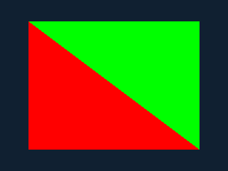

# Compiled original guest PICA draws

The adapter connects a bounded PICA draw subset to the standard guest GSP
queue. An original normal-CRT ARM application uses unmodified pinned libctru to
submit two command lists, retain uploaded shader/state between them, render
indexed triangles into owned linear allocations and display both screens.
The default `draw` profile uses CPU software rendering. Optional GX2 profiles
translate the bounded vertex shader, sample Texture0 when enabled and draw into
an owned GPU surface before the same guest display transfers. General PICA
behavior remains unsupported.

## Build and run the original program

After the [verified SDK and ARM fixture setup](compiled-homebrew.md), run:

```sh
python3 tools/validate-libctru.py --application draw --wiiu --sanitize \
  --output artifacts/reports/compiled-draw-local
```

The output directory must be new. The report records the source commit and dirty
state, library pin/hash, generated code identity, exact frame comparisons and
RPX/WUHB hashes. The original program executes **17,420,794 ARM instructions**
with zero fallback, four draws, four triangles, **97,200 covered fragments** and
36 vertex shader instructions. Its own target and transferred framebuffer checks
must pass before it prints `CTR2WUP compiled PICA draws PASS` and exits.

The host runner checks every displayed pixel. A separate integer Python image
oracle independently compares all **172,800 top/bottom pixels** in the captured
PPMs. The two images show a dark background and a central region divided diagonally into
red and green triangles; top and bottom display sizes are 400×240 and 320×240.

The images below are original host captures, not console screenshots:




CI executes the sanitized original guest and native build on each PR. Download
`wiiu-guest-draws-<source commit>` for the checked RPX/WUHB, PPM images, report,
checksums, source/SDK provenance and notices. This artifact contains original
diagnostics; it is not a game WUP or a physical-console result.

## GX2 guest backend

Build the distinct native profile with:

```sh
python3 tools/validate-libctru.py --application draw --wiiu --gx2 --sanitize \
  --output artifacts/reports/compiled-gx2-local
```

The native adapter receives decoded original vertex inputs, index order, uniforms
and retained PICA state. It compiles MOV/ADD/MUL/NOP/END into Latte vertex code,
then uses GX2 fetch, shader and triangle draw commands. The original `draw`
application binds an untextured primary-color pixel shader; `textured` uses the
bounded sampler/TEV path below. CPU-transformed positions, colors and UV are never
substituted for shader inputs. The [shader ABI](software-scenes.md#gx2-shader-and-backend-contract)
defines the supported translation.

A complete software preflight validates the list and computes reference pixels
before any native submission. The GPU target starts with the original target
contents; its synchronous readback must match every staged target byte before
guest pixels, retained state, memory generations or P3D completion commit.
Backend failures and mismatches fail the list without software fallback.
The existing TXT trace retains a hash and 4×4 RGBA sample grid for each retired
GPU readback, including pixels from a list later rejected for parity.

CI artifact `wiiu-gx2-guest-<source commit>` contains the separately named
`ctr2wup-gx2-guest.rpx`/`.wuhb`, reference images, provenance and one short
`START-HERE.md` guide. The report distinguishes host software frame checks,
independent shader validation and native cross-compilation. Physical GPU
execution and raster parity remain unverified; retained CPU preflight and
readback costs preclude a performance claim.

### Textured Guest

```sh
python3 tools/validate-libctru.py --application textured --wiiu --gx2 --sanitize \
  --output artifacts/reports/compiled-textured-local
```

This distinct original application submits retained shader/texture state and
tests sample replacement and primary-color modulation. Its patterned top/bottom
frames receive independent exact host comparison. The native build is named
`CTR2WUP Textured Guest`, with `ctr2wup-textured-guest.rpx`/`.wuhb` in CI artifact
`wiiu-textured-guest-<source commit>`. Source identity, checked reference images,
notices and one two-step `START-HERE.md` guide accompany the binaries.

The [texture contract](textures.md) covers all 14 base formats, 8..1024 dimensions,
nearest clamp/repeat/mirror, exact Q16 UV with W=1, and replace/binary-primary
modulation. Decoded texture storage has explicit ownership; native pitched upload
reverses rows for PICA V origin, flushes caches and retires GPU references before
reuse/free. Physical sampling parity and performance remain unverified.

## Resource and transaction contract

- Commands arrive through the existing standard GSP/GX command-list operation;
  configuration-only lists retain the previous behavior.
- Vertex/index resources and targets resolve only to tracked owned Old-family
  linear allocations: guest VA `0x14000000` maps to PA `0x20000000`. Static guest
  mappings, VRAM and unowned physical addresses are rejected.
- Permission splits must retain allocation identity. Source spans need read
  permission; tiled targets need read/write permission. Geometry snapshots are
  bounded to 4 MiB. Texture data must fit wholly in geometry or one of at most
  32 separate snapshots with 4 MiB total additional source bytes. Separate spans
  cannot overlap geometry or each other; partial geometry aliases fail. Relay
  memory, command-list/target aliases and source/target feedback fail.
- One resource base and one target binding are supported per command list.
  Changing either between draws fails transactionally. State writes after the
  last draw may prepare the next list; shader/configuration-only uploads persist.
  Texture bindings may change between draws within the checked snapshots.
- Targets are 8×8 Morton tiled RGBA8/ABGR storage, with dimensions that are multiples
  of eight and no larger than 512. The adapter converts to the renderer's linear
  RGBA view, then writes the complete target through checked guest memory once.
- Supported fragment state is explicitly defined: primary-color replacement or
  bounded Texture0 replace/modulate TEV, disabled lighting/depth/stencil/blending,
  copy logic and full color writes. TEV operands/scales are zero; later stages
  pass Previous. Required registers need fully defined byte masks. Unsupported
  or incomplete state fails before publishing pixels, shader state or completion.
- Successful commit updates memory generations, invalidates affected code aliases
  and exclusive state, commits shader/register/counter state and publishes P3D
  completion. A failed list preserves its target and scene state. Earlier successful
  queue entries remain committed; the failing entry stays pending without its IRQ.

The [scene contract](software-scenes.md) defines the bounded loader, fixed
attribute, uniform and MOV/ADD/MUL/NOP/END shader subset. ADD/MUL
accept only exact normal float24/signed-zero results with integer evaluation and
transactional numeric rejection; [original arithmetic checks](software-scenes.md#exact-add-and-mul)
validate the exact numeric subset separately from this MOV fixture. Broader
arithmetic/filtering, mipmaps, perspective, general TEV, clipping and
depth/blend/stencil remain unsupported.
A raw VFP push/pop guard fix supports exact bit transfers
under CRT FPSCR controls; it does not enable unsupported arithmetic modes.

## Startup and limits

The original program uses the standalone startup profile, with known unavailable
lookups `APT:S`, `APT:A` and `ptm:sysm`. It reaches its own main/assertions/exit.
General applets, retail startup and commercial compatibility are unsupported.
Physical procedures belong to the matching diagnostic package. A successful
original draw does not establish useful game speed or complete renderer support.
